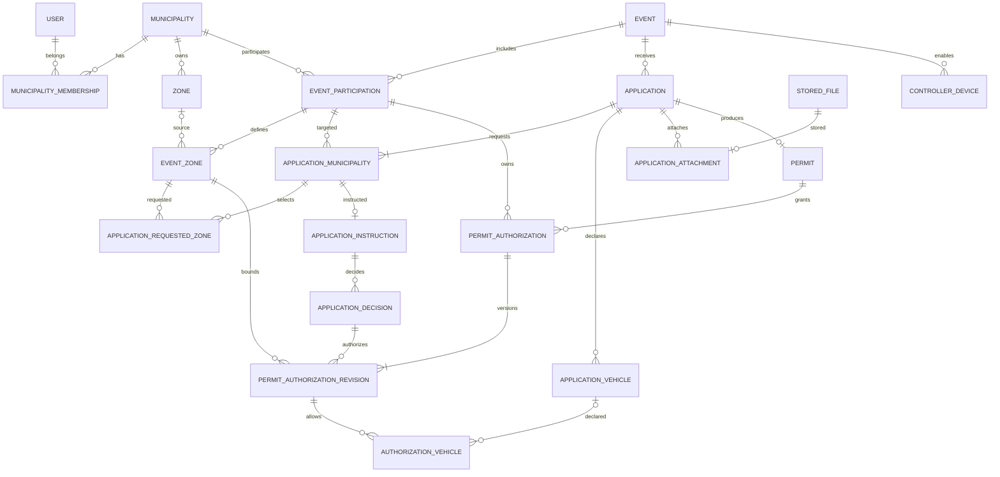

# CIVIPASS — Schéma technique de données V1.0

**Statut :** proposition technique détaillée pour revue, non encore transformée en migrations. **Date :** 01/11/2026. **Base :** MySQL 8 / Doctrine ORM. **Convention :** classes/propriétés PHP PascalCase/camelCase, tables et colonnes SQL snake_case.

## 1. Principes de modélisation
Identifiants internes `BIGINT UNSIGNED` ou UUID/ULID à arbitrer au bootstrap ; les références publiques utilisent des identifiants non séquentiels. Dates techniques en UTC (`DATETIME(6)`), présentation en fuseau Europe/Paris selon événement ; champs `created_at`, `updated_at` sauf tables immuables ; FKs indexées ; suppression restrictive par défaut. Éviter les cascades sur décisions, révisions, audit et autorisations. Les types indiqués sont des cibles Doctrine/MySQL, à affiner.

Les tables ci-dessous sont **le dictionnaire initial** : PK `id` implicite sauf tables de liaison, FK suffixée `_id`, `NOT NULL` sauf indication `?`. Les énumérations sont des chaînes contrôlées par enums PHP, et non nécessairement des ENUM MySQL.

## 2. Identité, communes et habilitations

### municipality
`id`, `name VARCHAR(180)`, `insee_code CHAR(5) UNIQUE`, `email VARCHAR(254)?`, `phone VARCHAR(32)?`, `status VARCHAR(30)`, `created_at`, `updated_at`. Index `status`.

### user
`id`, `email VARCHAR(254) UNIQUE`, `password_hash VARCHAR(255)`, `first_name VARCHAR(120)`, `last_name VARCHAR(120)`, `status VARCHAR(30)`, `last_login_at?`, `created_at`, `updated_at`. Email normalisé et unicité insensible à la casse ; pas de mot de passe transmis par administrateur.

### municipality_membership
`id`, `user_id FK`, `municipality_id FK`, `roles JSON` (liste d'enums validés), `status VARCHAR(30)`, `activated_at?`, `disabled_at?`, `created_at`, `updated_at`. `UNIQUE(user_id, municipality_id)`. Rôles cumulables et statut propres à la commune.

### user_invitation
`id`, `municipality_id FK`, `email VARCHAR(254)`, `roles JSON`, `token_hash CHAR(64) UNIQUE`, `expires_at`, `accepted_at?`, `invited_by_user_id FK?`, `created_at`. Index `(municipality_id, email)`, `expires_at`. Jeton brut jamais stocké.

### municipality_subscription
`id`, `municipality_id FK UNIQUE`, `plan_code VARCHAR(40)`, `status VARCHAR(30)`, `starts_at?`, `ends_at?`, `billing_reference?`, `created_at`, `updated_at`. Pas de paiement en ligne V1 ; invitation à un événement possible pour commune non abonnée selon règles métier.

## 3. Événements et géographie

### event
`id`, `public_reference VARCHAR(32) UNIQUE`, `organizer_municipality_id FK`, `title VARCHAR(200)`, `event_type VARCHAR(40)`, `description TEXT?`, `status VARCHAR(30)`, `starts_at?`, `ends_at?`, `activated_at?`, `closed_at?`, `created_by_user_id FK`, `created_at`, `updated_at`. Index `(status, starts_at)`.

### event_participation
`id`, `event_id FK`, `municipality_id FK`, `status VARCHAR(30)`, `invited_at?`, `activated_at?`, `suspended_at?`, `closed_at?`, `suspension_reason TEXT?`, `created_at`, `updated_at`. `UNIQUE(event_id, municipality_id)`. Index `(municipality_id, status)`.

### zone
`id`, `municipality_id FK`, `name VARCHAR(180)`, `description TEXT?`, `geometry JSON?` (GeoJSON validé ; stockage spatial natif à évaluer), `is_whole_municipality BOOLEAN`, `is_active BOOLEAN`, `created_at`, `updated_at`. Index `(municipality_id, is_active)`. Zone « Commune entière » par défaut, unicité fonctionnelle par commune.

### event_zone
`id`, `event_participation_id FK`, `source_zone_id FK?`, `name_snapshot VARCHAR(180)`, `description_snapshot TEXT?`, `geometry_snapshot JSON?`, `is_whole_municipality BOOLEAN`, `daily_start_time TIME?`, `daily_end_time TIME?`, `timezone VARCHAR(64)`, `status VARCHAR(30)`, `created_at`, `updated_at`. Index `(event_participation_id, status)`. Restriction horaire : soit les deux heures nulles, soit toutes deux renseignées ; gestion des créneaux traversant minuit à spécifier. La copie ne suit pas les changements de `zone`.

## 4. Demandes et données déclarées

### application
`id`, `event_id FK`, `public_reference VARCHAR(32) UNIQUE`, `first_name VARCHAR(120)`, `last_name VARCHAR(120)`, `email VARCHAR(254)?`, `phone VARCHAR(32)?`, `reason_code VARCHAR(50)`, `reason_details TEXT?`, `requested_pedestrian BOOLEAN`, `requested_bicycle BOOLEAN`, `requested_car BOOLEAN`, `status VARCHAR(30)`, `submitted_at`, `created_at`, `updated_at`. Contrôle métier : email OU téléphone obligatoire ; « autre » impose une description ; au moins un mode de déplacement. Index `(event_id, submitted_at)`. Pas de table citoyen globale.

### application_municipality
`id`, `application_id FK`, `event_participation_id FK`, `requested_at`, `created_at`. `UNIQUE(application_id, event_participation_id)` ; participation et demande doivent relever du même événement (validation applicative et tests).

### application_requested_zone
`id`, `application_municipality_id FK`, `event_zone_id FK`, `created_at`. `UNIQUE(application_municipality_id, event_zone_id)` ; zone de la participation sélectionnée. Ce rattachement évite les ambiguïtés d'une zone demandée dans un événement multi-communes.

### application_vehicle
`id`, `application_id FK`, `registration_number VARCHAR(32)`, `registration_normalized VARCHAR(32)`, `vehicle_type VARCHAR(40)?`, `status VARCHAR(30)`, `created_at`, `updated_at`. Index `(application_id, registration_normalized)`. Ne jamais utiliser cette valeur mutable pour valider une autorisation passée.

### stored_file
`id`, `storage_key VARCHAR(255) UNIQUE`, `storage_backend VARCHAR(30)`, `original_name VARCHAR(255)`, `mime_type VARCHAR(120)`, `size_bytes BIGINT`, `checksum_sha256 CHAR(64)?`, `uploaded_at`, `deleted_at?`. Clé opaque ; aucune URL publique.

### application_attachment
`id`, `application_id FK`, `stored_file_id FK UNIQUE`, `uploaded_at`, `uploaded_by_user_id FK?`. Maximum 5 fichiers et 10 Mo chacun contrôlés en service et validateur ; règles de conservation liées au dossier.

### application_idempotency
`id`, `event_id FK`, `key_hash CHAR(64)`, `application_id FK?`, `expires_at`, `created_at`, `UNIQUE(event_id, key_hash)`. Empêche les doubles dépôts techniques ; ne sert pas de détection nominative des doublons.

## 5. Instruction, décisions et corrections

### application_instruction
`id`, `application_municipality_id FK UNIQUE`, `status VARCHAR(40)`, `assigned_user_id FK?`, `locked_by_user_id FK?`, `lock_expires_at?`, `created_at`, `updated_at`. Verrou 15 min d'inactivité ; override administrateur audité. Index `(status, updated_at)` et `(locked_by_user_id, lock_expires_at)`.

### application_decision
`id`, `application_instruction_id FK`, `decision_type VARCHAR(40)`, `reason_code VARCHAR(50)?`, `reason_text TEXT?`, `decided_by_user_id FK`, `decided_at`, `metadata JSON?`. **Immuable** ; index `(application_instruction_id, decided_at)`. Toute nouvelle décision s'ajoute ; aucune réécriture d'une décision passée.

### instruction_note
`id`, `application_instruction_id FK`, `author_user_id FK`, `body TEXT`, `created_at`, `updated_at?`. Notes internes visibles seulement par la commune concernée ; modifications auditées.

### application_change
`id`, `application_id FK`, `changed_by_user_id FK`, `change_type VARCHAR(50)`, `before_data JSON?`, `after_data JSON?`, `changed_at`. Historique métier ciblé, limité aux données nécessaires, accès strict et rétention définie ; ne remplace pas AuditLog.

## 6. Laissez-passer, droits et révisions

### permit
`id`, `application_id FK UNIQUE`, `public_reference VARCHAR(32) UNIQUE`, `qr_token_hash CHAR(64) UNIQUE`, `issued_at`, `status VARCHAR(30)`, `created_at`, `updated_at`. Le QR contient un jeton opaque ; rotation exceptionnelle uniquement via procédure explicite auditée. Aucun droit directement dans le QR.

### permit_authorization
`id`, `permit_id FK`, `event_participation_id FK`, `created_from_decision_id FK`, `status VARCHAR(30)`, `created_at`, `revoked_at?`. Une autorisation logique appartient à une seule participation ; révocation définitive de cette autorisation. Index `(permit_id, status)`, `(event_participation_id, status)`.

### permit_authorization_revision
`id`, `permit_authorization_id FK`, `revision_number INT`, `decision_id FK`, `event_zone_id FK`, `valid_from DATETIME(6)?`, `valid_until DATETIME(6)?`, `allow_pedestrian BOOLEAN`, `allow_bicycle BOOLEAN`, `allow_car BOOLEAN`, `status VARCHAR(30)`, `created_at`, `created_by_user_id FK`. `UNIQUE(permit_authorization_id, revision_number)`. Révision **immuable**. Index `(event_zone_id, valid_from, valid_until)`. L'absence de dates doit être interdite ou strictement encadrée avant implémentation ; par défaut dates obligatoires pour un droit accordé.

### authorization_vehicle
`id`, `permit_authorization_revision_id FK`, `application_vehicle_id FK?`, `registration_snapshot VARCHAR(32)`, `registration_normalized_snapshot VARCHAR(32)`, `created_at`. `UNIQUE(permit_authorization_revision_id, registration_normalized_snapshot)`. L'immatriculation figée garantit qu'une correction du dossier ne change pas les droits déjà accordés.

**Version courante :** ne pas utiliser un booléen `is_current` fragile. Déterminer la dernière révision validée par numéro sous verrou transactionnel ; optimiser par un pointeur `current_revision_id` sur `permit_authorization` uniquement si nécessaire et avec invariant vérifié. Les droits sont calculés à partir de la révision courante et des statuts événement/participation/zone.

## 7. Exploitation, notifications et contrôleurs

### controller_device
`id`, `event_id FK`, `activated_by_user_id FK`, `device_label VARCHAR(120)?`, `credential_hash CHAR(64)`, `status VARCHAR(30)`, `activated_at`, `last_sync_at?`, `disabled_at?`, `expires_at?`. Index `(event_id, status)` ; limite de 10 appareils actifs par événement contrôlée transactionnellement. L'activation QR de 30 min doit utiliser un jeton d'activation distinct, à usage limité.

### controller_activation_token
`id`, `event_id FK`, `token_hash CHAR(64) UNIQUE`, `expires_at`, `used_at?`, `created_by_user_id FK`, `created_at`. Ne pas confondre avec QR de laissez-passer.

### notification
`id`, `application_id FK?`, `permit_id FK?`, `municipality_id FK?`, `channel VARCHAR(20)`, `template_code VARCHAR(80)`, `recipient_encrypted TEXT?`, `status VARCHAR(30)`, `idempotency_key VARCHAR(120) UNIQUE`, `attempt_count INT`, `provider_reference VARCHAR(120)?`, `last_error_code VARCHAR(60)?`, `created_at`, `sent_at?`. Données de contact minimisées, accès et rétention restreints ; envoi via Messenger.

### audit_log
`id`, `occurred_at`, `actor_user_id FK?`, `actor_type VARCHAR(30)`, `municipality_id FK?`, `event_id FK?`, `action VARCHAR(100)`, `entity_type VARCHAR(100)`, `entity_id VARCHAR(64)`, `metadata JSON?`, `correlation_id VARCHAR(64)?`. Append-only côté application ; index `(municipality_id, occurred_at)`, `(event_id, occurred_at)`, `(entity_type, entity_id)`. Pas de logs de scans ni PII superflue.

## 8. Cardinalités principales
- `Municipality 1—N MunicipalityMembership N—1 User`.
- `Event 1—N EventParticipation N—1 Municipality` ; unicité `(event, municipality)`.
- `Municipality 1—N Zone` ; `EventParticipation 1—N EventZone` ; `EventZone N—0..1 Zone` (source facultative).
- `Event 1—N Application` ; `Application 1—N ApplicationMunicipality N—1 EventParticipation`.
- `ApplicationMunicipality 1—N ApplicationRequestedZone N—1 EventZone`.
- `Application 1—N ApplicationVehicle` ; `Application 1—N ApplicationAttachment N—1 StoredFile`.
- `ApplicationMunicipality 1—0..1 ApplicationInstruction` ; instruction 1—N décisions.
- `Application 1—0..1 Permit` ; `Permit 1—N PermitAuthorization` ; autorisation 1—N révisions ; révision 1—N véhicules figés.
- `Event 1—N ControllerDevice` ; `Event 1—N ControllerActivationToken`.

## 9. Diagramme ER — Mermaid (vue métier)

## 10. Contraintes métier non garanties par FK simple
**Contrôles applicatifs transactionnels obligatoires et tests :** (1) `application.event_id = application_municipality.event_participation.event_id` ; (2) zone demandée et zone autorisée appartenant à la participation visée ; (3) autorisation, décision, instruction et dossier alignés sur la même commune/événement ; (4) seul un agent habilité de la commune crée une décision ou révise ses droits ; (5) une seule révision courante, numéro monotone ; (6) nouvelle révision ne peut élargir des droits sans décision explicite ; (7) une autorisation révoquée n'est pas réactivée ; (8) chaque droit accordé possède dates et au moins un mode ; (9) au plus 10 contrôleurs actifs par événement ; (10) pas d'accès transversal à la PII par un organisateur sans instruction propre.

Les services d'écriture doivent utiliser transactions et verrouillage optimiste/pessimiste selon les opérations ; les contraintes d'unicité doivent rester le dernier rempart contre la concurrence.

## 11. Suppression, archivage et protection
Pas de `ON DELETE CASCADE` sur le cœur historique. Clôture puis période de lecture seule (cible 30 jours), ensuite purge/archivage selon politique validée juridiquement. Séparer durée de conservation des pièces, identité, décisions et audit ; ne pas conserver indéfiniment des données nominatives au seul motif d'audit. Pour les suppressions de fichiers : marquer en attente, supprimer physiquement de façon idempotente puis confirmer. Sauvegardes chiffrées, restauration testée, gestion des copies hors production.

## 12. Points de revue avant migrations
1. Choix UUID/ULID vs BIGINT et stratégie des identifiants publics.
2. Représentation des géométries et recherche spatiale MySQL.
3. Modèle exact des statuts Workflow et des demandes de complément.
4. Gestion des modifications d'identité partagée et consentement/information du demandeur.
5. Autorisation de plusieurs zones : une autorisation logique par zone, et comportement des révisions lors d'un changement de zone.
6. Dates, créneaux traversant minuit, fuseau et changement d'heure.
7. Éventuels champs `event_zone` nécessaires pour figer les restrictions après activation.
8. Règles juridiques de conservation et périmètre des données publiques du QR.
9. Schéma de jetons, chiffrement et politique de rotation des secrets.
10. Politique de mise à jour des véhicules et conflits multi-communes.

**Statut final :** schéma prêt pour revue d'architecture, pas encore autorisé pour génération automatique des migrations Doctrine.
