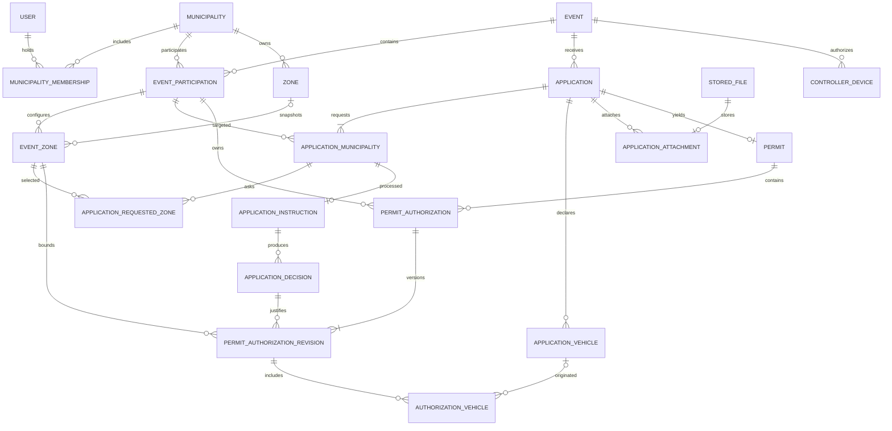

# CIVIPASS — Spécifications techniques détaillées V1.1

**Statut :** document de conception technique pour revue et validation, non prêt à lancer automatiquement toutes les migrations. **Date :** 01/11/2026. **Références :** ARCH-001 à ARCH-012, MCD-001 à MCD-003. **Sources :** spécifications techniques V1.0 et schéma de données V1.0, consolidés ici.

> **Portée du document.** Cette version regroupe architecture, MCD, dictionnaire de données avec typage, contraintes, workflows, sécurité, API, PWA, tests et exploitation. Les points marqués « À ARBITRER » ne doivent pas être inventés par un agent de développement.

## 0. Statut et conventions de lecture

- **VALIDÉ** : choix acté lors du cadrage. **PROPOSÉ** : conception recommandée à relire. **À ARBITRER** : décision bloquante avant la migration ou la fonctionnalité concernée.
- Les colonnes de dictionnaire utilisent les types **MySQL cibles**, pas nécessairement les annotations Doctrine finales. `?` signifie nullable. `FK` désigne une clé étrangère, `PK` une clé primaire.
- `created_at`, `updated_at` sont `DATETIME(6) NOT NULL` par défaut quand indiqués ; `id` est une PK technique **dont le format est à arbitrer**. Les colonnes FK utilisent le même type que la PK référencée.
- Toutes les dates techniques sont stockées en UTC. Les règles horaires locales sont évaluées dans le fuseau de l'événement.

## 1. Vision du MCD et frontières de données

**Frontières de confidentialité :** `Application` et ses données déclaratives sont partagées uniquement avec les communes explicitement sollicitées ; `ApplicationInstruction`, `ApplicationDecision` et `InstructionNote` sont propres à une commune ; les droits sont rattachés à une `EventParticipation`. Une commune organisatrice n'accède pas aux dossiers nominaux des autres communes au seul titre d'organisatrice.

**Cardinalités structurantes :** une demande appartient à un événement ; une demande cible une ou plusieurs participations ; au plus une instruction par demande/participation ; au plus un permis par demande ; zéro à plusieurs droits par permis ; une ou plusieurs révisions par droit accordé ; zéro à plusieurs véhicules par révision (mais au moins un si `allowCar=true`).

## 2. Architecture applicative et flux principaux

- **Runtime :** monolithe modulaire Symfony, Doctrine/MySQL 8, Twig + Stimulus + TypeScript + Turbo ; Sonata réservé au super-admin CWS ; deux PWA distinctes.
- **Modules :** `IdentityAccess`, `Municipality`, `EventManagement`, `ApplicationManagement`, `Instruction`, `Permit`, `Control`, `Notification`, `Audit`, `SharedInfrastructure`.
- **Frontières :** UI/HTTP → DTO + validation → cas d'usage applicatif → domaine → repository/adapter ; aucun contrôleur ne modifie directement les entités pour contourner les règles métier.
- **Transactions :** décisions, révisions, révocations et audit doivent être cohérents dans la même transaction ; notifications asynchrones émises via outbox transactionnelle ou mécanisme équivalent à spécifier.
- **Stockage :** `FileStorageInterface` avec backend local privé V1 et backend S3 ultérieur ; les chemins physiques ne remontent pas au domaine.

### 2.1 Séquence — dépôt public

1. L'administré ouvre un formulaire lié à un événement actif et choisit explicitement les communes.
2. Le serveur valide identité/contact, motif, modes, zones, véhicules et pièces ; contrôle l'idempotency key.
3. Une transaction crée `Application`, ses associations communales, véhicules, zones demandées, pièces et instructions correspondantes.
4. Le système produit une référence publique et une confirmation **sans autorisation implicite** ; notifications éventuelles après commit.

### 2.2 Séquence — décision et émission

1. Un agent authentifié sélectionne une instruction de sa commune ; le service vérifie membership, statut événement/participation et verrou métier.
2. Une décision favorable est enregistrée de façon immuable.
3. Le `Permit` unique est créé à la première approbation, si absent ; les droits zonaux sont créés avec leur première révision et leurs plaques figées.
4. L'audit est écrit transactionnellement ; le PDF et les notifications sont traités sans compromettre la transaction métier.
5. Une autre commune peut approuver ou refuser sans écraser les droits existants.

### 2.3 Séquence — contrôle QR

1. Le QR contient uniquement une URL HTTPS et un secret opaque à forte entropie ; aucune donnée personnelle embarquée.
2. Le serveur recherche le permis par empreinte et calcule les droits effectifs depuis les **révisions courantes**, les états d'événement/participation/zone, les dates et plages horaires.
3. La réponse publique est minimisée, limitée en débit et ne donne pas accès aux justificatifs ni aux notes.
4. En mode hors ligne, la PWA affiche un état non validant, jamais vert ; aucune trace nominative des scans n'est conservée.

## 3. Dictionnaire de données exhaustif — périmètre V1

**Lecture :** la liste ci-dessous est la base de spécification des champs. Les champs et règles additionnels de sécurité, de versionnement et d'indexation sont précisés dans les sections suivantes. Le choix de PK (`BIGINT` ou `ULID`) reste à arbitrer.
### 3.1 — `municipality`

**Domaine :** 2. Identité, communes et habilitations. **PK implicite :** `id` (type à arbitrer).

| Champ | Type MySQL cible | Nullable | Contrainte / remarque |
|---|---|---|---|
| `id` | `À préciser` | Non | ` |

### 3.2 — `user`

**Domaine :** 2. Identité, communes et habilitations. **PK implicite :** `id` (type à arbitrer).

| Champ | Type MySQL cible | Nullable | Contrainte / remarque |
|---|---|---|---|
| `id` | `À préciser` | Non | ` |

### 3.3 — `municipality_membership`

**Domaine :** 2. Identité, communes et habilitations. **PK implicite :** `id` (type à arbitrer).

| Champ | Type MySQL cible | Nullable | Contrainte / remarque |
|---|---|---|---|
| `id` | `À préciser` | Non | ` |

### 3.4 — `user_invitation`

**Domaine :** 2. Identité, communes et habilitations. **PK implicite :** `id` (type à arbitrer).

| Champ | Type MySQL cible | Nullable | Contrainte / remarque |
|---|---|---|---|
| `id` | `À préciser` | Non | ` |

### 3.5 — `municipality_subscription`

**Domaine :** 2. Identité, communes et habilitations. **PK implicite :** `id` (type à arbitrer).

| Champ | Type MySQL cible | Nullable | Contrainte / remarque |
|---|---|---|---|
| `id` | `À préciser` | Non | ` |

### 3.6 — `event`

**Domaine :** 3. Événements et géographie. **PK implicite :** `id` (type à arbitrer).

| Champ | Type MySQL cible | Nullable | Contrainte / remarque |
|---|---|---|---|
| `id` | `À préciser` | Non | ` |

### 3.7 — `event_participation`

**Domaine :** 3. Événements et géographie. **PK implicite :** `id` (type à arbitrer).

| Champ | Type MySQL cible | Nullable | Contrainte / remarque |
|---|---|---|---|
| `id` | `À préciser` | Non | ` |

### 3.8 — `zone`

**Domaine :** 3. Événements et géographie. **PK implicite :** `id` (type à arbitrer).

| Champ | Type MySQL cible | Nullable | Contrainte / remarque |
|---|---|---|---|
| `id` | `À préciser` | Non | ` |

### 3.9 — `event_zone`

**Domaine :** 3. Événements et géographie. **PK implicite :** `id` (type à arbitrer).

| Champ | Type MySQL cible | Nullable | Contrainte / remarque |
|---|---|---|---|
| `id` | `À préciser` | Non | ` |

### 3.10 — `application`

**Domaine :** 4. Demandes et données déclarées. **PK implicite :** `id` (type à arbitrer).

| Champ | Type MySQL cible | Nullable | Contrainte / remarque |
|---|---|---|---|
| `id` | `À préciser` | Non | ` |

### 3.11 — `application_municipality`

**Domaine :** 4. Demandes et données déclarées. **PK implicite :** `id` (type à arbitrer).

| Champ | Type MySQL cible | Nullable | Contrainte / remarque |
|---|---|---|---|
| `id` | `À préciser` | Non | ` |

### 3.12 — `application_requested_zone`

**Domaine :** 4. Demandes et données déclarées. **PK implicite :** `id` (type à arbitrer).

| Champ | Type MySQL cible | Nullable | Contrainte / remarque |
|---|---|---|---|
| `id` | `À préciser` | Non | ` |

### 3.13 — `application_vehicle`

**Domaine :** 4. Demandes et données déclarées. **PK implicite :** `id` (type à arbitrer).

| Champ | Type MySQL cible | Nullable | Contrainte / remarque |
|---|---|---|---|
| `id` | `À préciser` | Non | ` |

### 3.14 — `stored_file`

**Domaine :** 4. Demandes et données déclarées. **PK implicite :** `id` (type à arbitrer).

| Champ | Type MySQL cible | Nullable | Contrainte / remarque |
|---|---|---|---|
| `id` | `À préciser` | Non | ` |

### 3.15 — `application_attachment`

**Domaine :** 4. Demandes et données déclarées. **PK implicite :** `id` (type à arbitrer).

| Champ | Type MySQL cible | Nullable | Contrainte / remarque |
|---|---|---|---|
| `id` | `À préciser` | Non | ` |

### 3.16 — `application_idempotency`

**Domaine :** 4. Demandes et données déclarées. **PK implicite :** `id` (type à arbitrer).

| Champ | Type MySQL cible | Nullable | Contrainte / remarque |
|---|---|---|---|
| `id` | `À préciser` | Non | ` |

### 3.17 — `application_instruction`

**Domaine :** 5. Instruction, décisions et corrections. **PK implicite :** `id` (type à arbitrer).

| Champ | Type MySQL cible | Nullable | Contrainte / remarque |
|---|---|---|---|
| `id` | `À préciser` | Non | ` |

### 3.18 — `application_decision`

**Domaine :** 5. Instruction, décisions et corrections. **PK implicite :** `id` (type à arbitrer).

| Champ | Type MySQL cible | Nullable | Contrainte / remarque |
|---|---|---|---|
| `id` | `À préciser` | Non | ` |

### 3.19 — `instruction_note`

**Domaine :** 5. Instruction, décisions et corrections. **PK implicite :** `id` (type à arbitrer).

| Champ | Type MySQL cible | Nullable | Contrainte / remarque |
|---|---|---|---|
| `id` | `À préciser` | Non | ` |

### 3.20 — `application_change`

**Domaine :** 5. Instruction, décisions et corrections. **PK implicite :** `id` (type à arbitrer).

| Champ | Type MySQL cible | Nullable | Contrainte / remarque |
|---|---|---|---|
| `id` | `À préciser` | Non | ` |

### 3.21 — `permit`

**Domaine :** 6. Laissez-passer, droits et révisions. **PK implicite :** `id` (type à arbitrer).

| Champ | Type MySQL cible | Nullable | Contrainte / remarque |
|---|---|---|---|
| `id` | `À préciser` | Non | ` |

### 3.22 — `permit_authorization`

**Domaine :** 6. Laissez-passer, droits et révisions. **PK implicite :** `id` (type à arbitrer).

| Champ | Type MySQL cible | Nullable | Contrainte / remarque |
|---|---|---|---|
| `id` | `À préciser` | Non | ` |

### 3.23 — `permit_authorization_revision`

**Domaine :** 6. Laissez-passer, droits et révisions. **PK implicite :** `id` (type à arbitrer).

| Champ | Type MySQL cible | Nullable | Contrainte / remarque |
|---|---|---|---|
| `id` | `À préciser` | Non | ` |

### 3.24 — `authorization_vehicle`

**Domaine :** 6. Laissez-passer, droits et révisions. **PK implicite :** `id` (type à arbitrer).

| Champ | Type MySQL cible | Nullable | Contrainte / remarque |
|---|---|---|---|
| `id` | `À préciser` | Non | ` |

### 3.25 — `controller_device`

**Domaine :** 7. Exploitation, notifications et contrôleurs. **PK implicite :** `id` (type à arbitrer).

| Champ | Type MySQL cible | Nullable | Contrainte / remarque |
|---|---|---|---|
| `id` | `À préciser` | Non | ` |

### 3.26 — `controller_activation_token`

**Domaine :** 7. Exploitation, notifications et contrôleurs. **PK implicite :** `id` (type à arbitrer).

| Champ | Type MySQL cible | Nullable | Contrainte / remarque |
|---|---|---|---|
| `id` | `À préciser` | Non | ` |

### 3.27 — `notification`

**Domaine :** 7. Exploitation, notifications et contrôleurs. **PK implicite :** `id` (type à arbitrer).

| Champ | Type MySQL cible | Nullable | Contrainte / remarque |
|---|---|---|---|
| `id` | `À préciser` | Non | ` |

### 3.28 — `audit_log`

**Domaine :** 7. Exploitation, notifications et contrôleurs. **PK implicite :** `id` (type à arbitrer).

| Champ | Type MySQL cible | Nullable | Contrainte / remarque |
|---|---|---|---|
| `id` | `À préciser` | Non | ` |

## 4. Contraintes relationnelles, index et invariants

| Table | Contrainte / index | Justification |
|---|---|---|
| `municipality` | `UNIQUE(insee_code)` | Identité de la commune |
| `user` | `UNIQUE(email)` sur email normalisé | Un compte par email |
| `municipality_membership` | `UNIQUE(user_id, municipality_id)` | Une adhésion par couple |
| `event_participation` | `UNIQUE(event_id, municipality_id)` | Une participation par commune/événement |
| `application_municipality` | `UNIQUE(application_id, event_participation_id)` | Pas de double sollicitation |
| `application_requested_zone` | `UNIQUE(application_municipality_id, event_zone_id)` | Pas de zone demandée en doublon |
| `application_instruction` | `UNIQUE(application_municipality_id)` | Une instruction communale par demande |
| `permit` | `UNIQUE(application_id)`, `UNIQUE(qr_token_hash)` | Un QR par dossier, jeton non prédictible |
| `permit_authorization_revision` | `UNIQUE(permit_authorization_id, revision_number)` | Versions monotones |
| `authorization_vehicle` | `UNIQUE(permit_authorization_revision_id, registration_normalized_snapshot)` | Pas de plaque en double par révision |
| `application_idempotency` | `UNIQUE(event_id, key_hash)` | Anti-double dépôt |
| `controller_activation_token` | `UNIQUE(token_hash)` | Activation non réutilisable |

**Index de lecture :** `(event_id, submitted_at)` sur demandes ; `(municipality_id, status)` sur participations ; `(event_participation_id, status)` sur zones et autorisations ; `(application_instruction_id, decided_at)` sur décisions ; `(municipality_id, occurred_at)` sur audit ; `(event_id, status)` sur contrôleurs. Les index définitifs seront confirmés par les requêtes réellement implémentées et `EXPLAIN`.

**Invariants multi-communes à contrôler dans les services transactionnels et les tests :**

1. Une commune sollicitée appartient au même événement que la demande.
2. Une zone demandée appartient à la participation communale ciblée.
3. Une décision appartient à l'instruction de la commune qui crée ou modifie ses droits.
4. Une révision ne peut référencer qu'une zone de la même participation et un véhicule du même dossier.
5. Une décision validée et une révision ne sont jamais modifiées rétroactivement.
6. Une autorisation révoquée ne redevient pas active ; un nouvel octroi crée un nouveau droit.
7. Une autorisation véhicule requiert au moins une plaque figée si la voiture est autorisée.
8. La création de révisions concurrentes est sérialisée par verrou transactionnel ou version optimiste ; jamais deux versions courantes.
9. Une commune organisatrice ne voit pas les informations nominatives d'une commune non sollicitée.
10. Les écritures sensibles et l'audit associé sont atomiques.

## 5. Workflows — états et transitions

| Agrégat | États V1 proposés | Transitions et gardes principales |
|---|---|---|
| `Event` | `draft`, `active`, `suspended`, `closed` | `draft→active` si zone définie ; `active↔suspended` avec motif à la suspension ; `active/suspended→closed` si toutes les participations sont clôturées |
| `EventParticipation` | `invited`, `active`, `suspended`, `closed` | Activation par commune habilitée ; suspension avec raison ; réactivation si événement compatible ; clôture irréversible |
| `ApplicationInstruction` | `pending`, `inReview`, `additionalInfoRequested`, `approved`, `refused` | Transitions à détailler selon compléments et modifications ; décisions immuables distinctes de l'état courant |
| `PermitAuthorization` | `active`, `revoked` | Révocation motivée irréversible ; prolongation via nouvelle révision, pas modification directe |

**À ARBITRER :** matrice exacte des transitions après refus et après demande de complément, statut du dossier partagé, modalités de réouverture d'instruction et versionnement d'identité. Les noms ci-dessus ne sont pas encore une configuration Workflow prête à coller.

## 6. Contrats API — catalogue initial (proposition)

| Méthode | Route indicative | Acteur | Effet / contrôle |
|---|---|---|---|
| POST | `/api/v1/public/events/{eventRef}/applications` | Public | Dépôt validé, clé d'idempotence |
| GET | `/p/{opaqueToken}` | Public | Vérification minimale des droits courants, rate limit |
| GET | `/api/v1/municipalities/{municipalityId}/events` | Agent habilité | Liste filtrée au tenant |
| POST | `/api/v1/events` | Gestionnaire | Création d'événement et audit |
| POST | `/api/v1/events/{eventId}/activate` | Gestionnaire | Transition Workflow + gardes |
| GET | `/api/v1/instructions/{instructionId}` | Instructeur de la commune | Consultation dossier selon permissions |
| POST | `/api/v1/instructions/{instructionId}/decisions` | Instructeur | Décision immuable, droits, audit |
| POST | `/api/v1/authorizations/{authorizationId}/revisions` | Instructeur habilité | Nouvelle version transactionnelle |
| POST | `/api/v1/authorizations/{authorizationId}/revoke` | Instructeur habilité | Révocation motivée |
| GET | `/api/v1/permits/{permitId}/pdf` | Agent habilité | Document à accès contrôlé |
| POST | `/api/v1/control/devices/activate` | Contrôleur autorisé | Consommation du jeton temporaire |
| POST | `/api/v1/control/devices/sync` | Contrôleur autorisé | Synchronisation limitée au périmètre |

**Contrat transversal :** DTO dédiés, validation Symfony, pagination sur les listes, codes 400/401/403/404/409/422/429 selon contexte, messages sans fuite de données, `correlationId` non nominatif, `Idempotency-Key` sur les écritures exposées aux doubles envois. Les schémas JSON de chaque endpoint restent à formaliser **avant le lot correspondant**.

## 7. Matrice de sécurité et de cloisonnement

| Ressource / action | Administré public | Instructeur commune A | Gestionnaire commune A | Organisateur autre commune | CWS super-admin |
|---|---|---|---|---|---|
| Déposer demande événement actif | Oui | Oui via parcours public | Oui via parcours public | Oui via parcours public | Oui via parcours public |
| Voir dossier sollicitant A | Non | Oui, selon habilitation | Oui, selon habilitation | Non (agrégats uniquement) | Accès exceptionnel audité |
| Décider pour commune A | Non | Oui | Selon rôle cumulatif | Non | Intervention exceptionnelle encadrée |
| Modifier droit commune B | Non | Non | Non | Non | Intervention exceptionnelle encadrée |
| Voir notes internes commune A | Non | Oui | Selon permissions | Non | Accès exceptionnel audité |
| Vérifier QR public | Oui, données minimales | Oui | Oui | Oui | Oui |
| Activer appareil de contrôle | Non | Selon habilitation dédiée | Selon habilitation | Non par défaut | Selon politique d'exploitation |

**Exigences :** Voters sur l'objet et le tenant ; filtrage SQL en lecture ; tests d'IDOR ; pas de confiance dans le contexte commune du navigateur ; CSRF, CSP, HTTPS, cookies sécurisés, rate limiting, anti-bruteforce, validation des uploads, journal d'audit append-only. Les rôles précis et l'accès CWS exceptionnel doivent être revus avant production.

## 8. Spécification des PWA et du contrôle

- **PWA municipale :** responsive, connectée pour toute écriture métier ; cache d'assets uniquement, aucun mode instruction offline.
- **PWA contrôleur :** activation par jeton QR à durée de vie 30 min ; maximum 10 appareils actifs par événement ; synchronisation toutes les 15 min et dès reconnexion ; indicateur d'âge du cache.
- **12–24 h depuis dernière synchronisation :** alerte ; **plus de 24 h :** contrôle bloqué. **Hors ligne :** jamais de vert de validation.
- **Aucune journalisation des scans ou géolocalisation.** Cache minimal IndexedDB, purge à clôture/retrait local ; révocation distante applicable au prochain contact réseau.
- **À ARBITRER :** données nominatives réellement nécessaires dans le cache, politique de chiffrement local et scénario de perte/vol de l'appareil.

## 9. Fichiers, PDF, notifications et asynchrone

- Justificatifs : maximum 5 par demande, 10 Mo par fichier, PDF/JPG/JPEG/PNG/DOC ; contrôle extension, MIME réel, signatures et sécurité ; stockage local privé hors webroot ; téléchargement via contrôleur autorisé.
- PDF : A4 noir et blanc, QR, zones, périodes, modes et plaques ; impression groupée ≤50 ; papier valable au maximum 48 h depuis impression/réimpression et jamais après expiration des droits ; QR en ligne autoritatif.
- `FileStorageInterface` : `put`, `readStream`, `exists`, `delete` ; backend local V1 et S3 futur. Prévoir sauvegardes et restauration des fichiers avec la base.
- Messenger Doctrine : workers supervisés, retries bornés, failure transport, idempotence, alerting ; email/SMS via adaptateurs, SMS désactivable en tests. La fiabilité de publication des messages après transaction doit être spécifiée (outbox recommandée).

## 10. Normes de code et tests exécutables

- **Nommage :** camelCase variables/propriétés/méthodes/fonctions, PascalCase classes/interfaces, UPPER_SNAKE_CASE constantes, snake_case SQL, kebab-case routes. PSR-12/PSR-4, `strict_types`, injection de dépendances, séparation des couches.
- **Outils :** PHPUnit, Symfony PHPUnit Bridge, PHPStan, PHP-CS-Fixer, ESLint, Prettier, `composer audit`. Versions figées après vérification PHP/Symfony/Sonata.
- **Commandes Makefile attendues :** `make test`, `make test-unit`, `make test-integration`, `make test-functional`, `make test-security`, `make quality` ; sorties fiables en CLI et CI.
- **Par feature :** tests unitaires des règles, tests d'intégration/HTTP adaptés, tests de permissions multi-tenants, tests de concurrence si écriture critique, test de régression par bug ; fixtures déterministes et base de test isolée.
- **Definition of Done :** comportement accepté, sécurité testée, qualité CLI verte, migrations relues, audit prévu, documentation actualisée, revue humaine, compte rendu des commandes exécutées par l'agent.

## 11. Infrastructure, déploiement et observabilité

- Docker local fourni par le porteur du projet, piloté par Makefile ; revue préalable Dockerfile/Compose avant installation. MySQL persistant, PHP-FPM, serveur web, worker Messenger et scheduler/cron.
- Environnements `dev`, `test`, `prod` isolés ; secrets hors Git ; CI GitHub Actions pour lint, analyse, tests, build et audit dépendances.
- Observabilité : erreurs, latence, files de messages, disponibilité, disque, sauvegardes, échecs d'envoi. Pas de logs de scans ; minimiser PII et secrets dans logs.
- Conservation : 30 jours de consultation opérationnelle après clôture comme hypothèse ; purge et archivage à valider juridiquement, notamment pour les documents détenus par les collectivités.

## 12. Points ouverts et conditions de démarrage

| Priorité | Sujet | Condition |
|---|---|---|
| Bloquant migrations | Type PK (`BIGINT` vs ULID) | Choix unique + stratégie de références publiques |
| Bloquant géographie | GeoJSON JSON vs géométrie spatiale | Définir opérations géographiques nécessaires |
| Bloquant workflows | États et transitions exhaustifs | Matrice de transitions validée |
| Bloquant sécurité | Périmètre des données publiques du QR | Validation produit + RGPD |
| Bloquant contrôle offline | Menace, cache et secrets de device | Modèle de menace et tests |
| Bloquant production | Politique d'archivage et purge | Validation juridique |
| Bootstrap | Versions PHP/Symfony/Sonata, assets | Vérification compatibilité sur Docker existant |
| Avant chaque lot | DTO, endpoints, cas d'erreur, tests | Contrat précis + critères d'acceptation |

**Règle de gouvernance :** un agent de code ne peut pas trancher seul un point « À ARBITRER », modifier l'architecture ou élargir l'accès aux données. Toute proposition doit être revue et validée avant implémentation.
